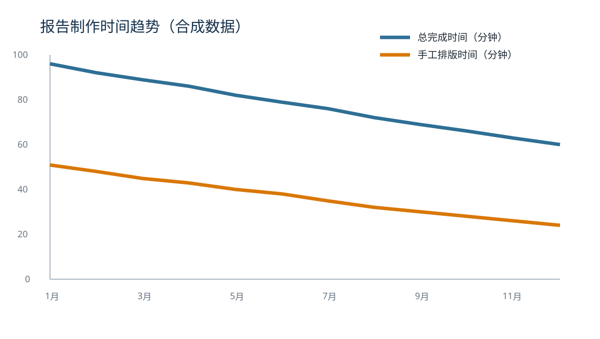
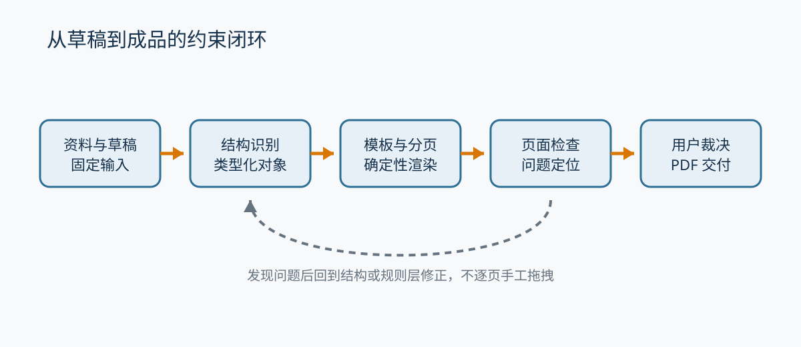

# AI 辅助长文交付流程效率观察报告

## 从内容草稿到专业 PDF 的时间、质量与风险

**报告性质：** PoC-A 固定排版样本  
**样本版本：** 1.0.0  
**编制日期：** 2026 年 7 月 20 日  
**适用读者：** 需要频繁交付分析报告的独立开发者、研究人员、咨询策划和内容工作者

> 重要说明：本报告中的机构、访谈、比例和时间数据均为合成内容，仅用于验证 10–20 页中文专业报告的结构、分页、表格、图片、目录、来源和导出效果。不得将其中数字用于产品、市场或投资决策。

[[PAGE_BREAK]]

# 执行摘要

生成式 AI 已显著降低长文初稿的获得成本，但“获得内容”与“完成交付”仍是两个不同任务。知识工作者常常可以在几十分钟内得到一篇结构基本完整的草稿，却仍需要在文字处理软件中花费大量时间清理标题层级、统一字体、调整表格、处理图片、检查目录页码并反复修复分页。合成观察样本显示，在传统流程中，一份中等长度分析报告的总完成时间虽然逐月下降，但手工排版仍占总时间的四成左右；当报告需要更新时，目录、图表和分页会再次发生连锁变化，第一次排好的页面不能直接复用。

问题的核心并不只是“排版按钮太多”。专业成品同时受到语义结构、视觉规范和物理页面约束：一级标题是否应另起一页，表格表头是否应在跨页后重复，图片和题注能否分离，标题能否孤立在页尾，来源链接是否越界，字体替换是否改变换行。这些约束相互影响，单次操作正确并不意味着最终页面合格。传统人工流程依赖操作者不断在局部调整和整体复查之间往返，AI 若只模拟鼠标与菜单，同样会受到操作序列脆弱、结果不可重复和缺少校验闭环的限制。

本报告提出一个用于实验的目标流程：先把草稿转换为带稳定类型的文档对象，再由声明式模板给出版式规则，由确定性渲染环境完成分页，并用页面检查器发现越界、遮挡、目录错误、表格断裂和标题落页尾等问题。AI 可以负责理解目标和提出修正计划，但所有变更必须转换为可预览、可接受、可拒绝和可撤销的事务；用户始终保留最终裁决权。

对 PoC-A 而言，最重要的不是展示复杂编辑功能，而是回答一个简单但严格的问题：固定输入、固定模板和固定字体能否连续生成稳定、可检查、可交付的 PDF。如果廉价的 Chromium 打印路径能够满足 10–20 页通用专业分析报告，它就值得成为首战基础；如果关键分页只能靠逐页特例和人工拖拽，项目应及时降级，而不是用更多功能掩盖排版地基尚未成立。

**核心观察：**

1. 内容生成速度已经不是唯一瓶颈，结构确认、排版修复和交付检查仍占用大量时间。
2. 页面质量问题具有可分类、可定位和部分可自动验证的特点，适合建立规则闭环。
3. 模板必须描述结构、分页与验证，而不只是颜色和字号；否则无法形成长期复用资产。
4. 固定字体与统一渲染器是建立可重复基线的前提，跨端一致性应以风险探针逐步验证。
5. 自动化价值应由“首次可接受 PDF 的总时间”和“人工排版时间”证明，而不是由功能数量证明。

[[TOC]]

# 一、观察背景与问题定义

## 1.1 从“写不出来”转向“交付不稳定”

过去，专业报告的主要成本集中在资料搜集、提纲组织和正文撰写。生成式 AI 普及后，用户能够更快地获得提纲、段落、摘要和改写建议，内容生产的边际成本持续降低。但是，一份可以阅读的回答并不天然是一份可以发送、打印或提交的文件。报告需要稳定的标题层级、清晰的表格、合适的图文关系、连续的页码、准确的目录以及不会因换一台电脑而大幅变化的字体与分页。

在合成访谈中，一名研究人员这样描述自己的工作：“草稿出来时，我觉得已经完成了百分之八十；等真正发出 PDF，才发现最后百分之二十消耗了一半时间。”另一名独立顾问则指出，最令人疲惫的不是第一次设置标题样式，而是修改一段内容后必须再次检查后面十几页。虽然这些话不是实际用户研究结论，却准确模拟了 PoC-A 需要处理的使用情境：内容会变化，页面约束会连锁变化，用户不希望每次更新都重新手工巡检。

## 1.2 本报告所称“专业成品”

本报告把“专业成品”限定为满足具体用途、具有一致结构、能够被接收者直接阅读或打印，并通过明确检查的 PDF 文件。它不要求达到杂志出版、严格公文、学术期刊或复杂财务报表的标准，也不要求导入任意 Word 文件后像素级复刻。首战关注的是通用专业分析报告：包含文字章节、普通数据表格、图片或图表，篇幅约 10–30 页。

“可交付”包含四层含义。第一，内容结构完整，标题、摘要、目录、正文和来源能够相互对应。第二，视觉层级一致，字体、颜色、间距和图表风格不会随机变化。第三，物理页面合格，没有越界、遮挡、错误断页和大面积异常空白。第四，生产过程可追踪，用户知道哪些内容来自原始资料、哪些由 AI 修改、哪些经过人工接受。

## 1.3 观察问题

本合成报告围绕以下问题组织排版材料：

- 从 AI 草稿到首次可接受 PDF，时间主要消耗在哪里？
- 哪些页面错误适合确定性检查，哪些仍需人工裁决？
- 模板如果要成为可执行资产，最低需要描述哪些规则？
- 浏览器分页路径的价值和潜在上限分别是什么？
- 如何避免为追求自动化而牺牲数据主权、可编辑性和恢复能力？

# 二、样本与观察方法

## 2.1 合成样本设计

本报告使用 12 个月的合成任务数据，模拟一个小型知识工作团队逐步改善报告交付流程。每个月记录完成文件数量、中位总完成时间、中位手工排版时间、人工格式调整次数和实际交付比例。数据从年初的 18 份文件增长到年末的 52 份，总完成时间从 96 分钟下降到 60 分钟，手工排版时间从 51 分钟下降到 24 分钟。变化趋势用于测试折线图、表格分页和数字对齐，不代表真实生产率。

### 表 1　合成观察指标摘要

| 指标 | 年初值 | 年末值 | 变化 | 排版含义 |
|---|---:|---:|---:|---|
| 每月完成文件数 | 18 | 52 | +188.9% | 表格需处理百分比与右对齐数字 |
| 中位总完成时间 | 96 分钟 | 60 分钟 | -37.5% | 图表需要双序列和清晰图例 |
| 中位手工排版时间 | 51 分钟 | 24 分钟 | -52.9% | 核心效率观察指标 |
| 人工格式调整次数 | 22 | 10 | -54.5% | 用于模拟局部修复记录 |
| 实际交付比例 | 61% | 81% | +20 个百分点 | 注意百分比与百分点的表达差异 |

完整月度数据见附录 A。表格中的数字故意包含整数、百分数、负号和小数，以测试列宽、对齐、表头换行及跨页后的重复显示。

## 2.2 任务边界

观察计时从用户开始整理已有 AI 草稿时开始，到用户获得第一份愿意发送给外部接收者的 PDF 时结束。总时间包括结构清理、格式设置、图片调整、目录更新、页面巡检和导出；不包括最初资料搜集和正文观点形成。人工排版时间只记录直接用于样式、分页、表格、图片和目录修复的时间，不包含内容事实核查。

这种区分很重要。如果工具只是更快地生成更多文字，却让用户花费更长时间核查和排版，总完成时间未必下降。相反，一个不提供复杂写作功能、但能够稳定减少页面修复的工具，仍可能产生明确价值。PoC-A 因此把排版时间和首次可接受 PDF 作为核心，而不是把模型回答速度作为主要指标。

## 2.3 对照方法

同一份固定草稿分别进入传统文字处理流程和实验流程。传统流程允许用户使用自己熟悉的样式、目录和导出功能，但不能直接复用另一条路径已经完成的文件。实验流程只允许通过模板规则、结构调整和受控修正产生页面，不允许针对某一页写死绝对位置。两条路径采用相同的 PDF 合格标准，并记录软件版本、机器环境、开始与结束时间、格式调整次数以及未解决问题。

由于 0 号用户会随着重复操作变熟练，对照顺序应交替安排，或在两次任务之间保留足够间隔。若 Word 在测试环境不可用，应如实标注，不以 WPS 结果冒充 Word，也不因为缺少某个软件而修改实验标准。

# 三、当前长文交付流程中的主要损耗

## 3.1 结构清理

AI 草稿常用视觉符号表达结构，例如加粗段首、编号文本或不一致的 Markdown 标题。用户首先需要判断哪些内容是真正的章节、哪些只是强调语句、哪些表格应保持表格、哪些列表应转为正文。这个过程看似属于内容编辑，实际会直接影响目录、页眉、分页和引用。如果结构没有类型化，后续样式只能依赖脆弱的文本匹配。

结构清理还包括稳定标识。传统文档里，用户看到的是“第三章第二段”，但内容插入后这个位置会变化。若 AI 修改、引用和审计都依赖位置，后续就难以准确回答某句话来自哪里、哪次修改影响了哪些节点。因此，首战即使不做完整知识层，也应让关键对象具备稳定 ID，并让模板规则根据节点类型而不是屏幕坐标工作。

## 3.2 样式统一

人工样式问题通常不是单一字号错误，而是多个来源带来的局部差异。粘贴内容可能携带字体、行距和颜色；表格可能使用另一套默认样式；图片题注可能只是普通段落。用户通过格式刷或样式面板修复后，一旦新增内容，又可能出现新的局部偏差。

声明式模板应将颜色、字号、间距、标题层级、表格规则和页面规则集中描述，并且有版本。这样，修改模板是更新一套受控规范，而不是在文档中积累看不见的手工格式。模板升级仍需迁移与预览，因为规则变化可能让页数和目录整体移动，不能把“统一样式”误解为没有副作用。

## 3.3 分页连锁反应

分页是最难通过操作序列稳定解决的部分。一个段落增加两行，可能把后续标题推到页尾；移动标题又可能让上一页出现大块空白；保持图片和题注同页，又会推动表格跨页。局部修复经常产生新的全局问题，因此可靠流程必须在每次结构或样式变化后重新运行检查，而不是假设操作已经成功。

*图 1 来源：PoC-A 合成数据 `report-data.csv`。图中文字、图例、长宽比和题注用于验证图片与题注同页、来源紧随题注以及缩放后可读性。*

图 1 显示总完成时间和手工排版时间同步下降，但二者之间仍保留明显差距。这里不应推断真实因果关系；图的任务是提供一个宽幅、双序列、带图例的视觉对象，以测试图片能否在版心内按比例缩放，题注是否保持在同一页，来源行是否被孤立到下一页。

## 3.4 表格与图片

普通表格也包含多种页面约束：列宽需要适应中文标题和数字，表头在跨页后应重复，单行不应被切成上下两半，来源和备注应紧随表格。若表格过宽，系统应选择缩小字号、调整列宽、改为横向页或提示用户拆表，而不是直接让内容越出版心。首战不支持复杂合并单元格、嵌套表格和财务级计算，避免把排版 PoC 变成电子表格项目。

图片问题包括分辨率、比例、替代文本、题注和来源。系统应区分内容图片与装饰图片，避免无意义地给每个色块生成说明。对于本报告中的 SVG 图，渲染器还需验证矢量文本、字体 fallback 和 PDF 中的清晰度；如果某个平台不能稳定处理 SVG，应通过受控转换形成等价资源并记录，而不是在不同平台悄悄使用不同图。

# 四、从静态样式到可执行模板

## 4.1 模板的最低组成

可执行模板不是一组截图，也不只是 CSS 皮肤。它至少需要模板 ID、版本、支持的文档 schema、必需章节、布局 token、分页规则、validator、导出配置和迁移规则。模板必须能够回答：“这个标题应该怎样显示”“这个节点能否跨页”“缺少哪一节算结构不完整”“导出前必须检查什么”。

模板使用声明式 JSON 或受控 DSL，由规则引擎解释执行。规则引擎只暴露白名单能力，不允许模板执行任意 JavaScript、读取任意文件、发起网络请求或调用系统命令。这样既降低恶意模板风险，也提高渲染的可重复性和审计能力。未来模板市场若开放第三方内容，模板仍应经过 schema、版本兼容、资源许可证和执行预算检查。

## 4.2 三层约束

第一层是语义结构：封面、摘要、目录、章节、表格、图片、题注和来源分别是什么。第二层是版式规则：不同用途下这些对象使用何种字号、颜色、间距、宽度和保持关系。第三层是页面求解：对象进入具体 A4 页面后是否越界、遮挡、产生孤行或错误断页。

三层不能颠倒。如果内容没有结构，页面引擎只能猜测某个加粗段落是不是标题；如果没有版式规则，系统无法知道表格过宽时应调整哪一项；如果没有页面检查，再漂亮的模板也可能在真实长文中产生错误。AI 可以辅助第一层理解和第二层方案，但第三层结果必须被确定性测量和验证。

### 表 2　三层约束的责任与验证方式

| 层级 | 主要输入 | 主要输出 | 典型错误 | 验证方式 |
|---|---|---|---|---|
| 语义结构 | 草稿、附件、用户目标 | 类型化节点、稳定 ID、引用 | 标题误判、表格变正文、来源丢失 | schema、节点对账、用户确认 |
| 版式规则 | 文档类型、模板、受众 | 字号、间距、颜色、保持关系 | 层级混乱、样式漂移、表格不可读 | token 校验、模板快照、规则测试 |
| 页面求解 | 结构化内容、字体、纸张 | 具体页面与几何位置 | 越界、遮挡、孤行、目录错误 | 页面测量、PDF 解析、视觉回归 |

## 4.3 版本与迁移

模板版本变化可能改变所有页面，因此不能静默覆盖用户项目。项目应记录当时使用的模板 ID 和版本；用户选择升级时先生成预览和差异，说明页数、目录和问题检查的变化。旧模板仍应能够重现历史正式版本，或由明确迁移规则转换。若某个模板依赖已撤回字体或不兼容的 schema，系统应阻止无提示导出。

# 五、目标工作流与人类裁决

## 5.1 约束先于生成

用户在开始任务时应说明目标、受众、篇幅、模板、不可改项、不可猜测项和资料范围。模型根据这些约束提出结构或修改计划，但计划不直接改变正式文档。系统把计划编译为高层语义操作，例如重写某一章节、在指定节点后插入内容、把若干段落转换为表格或附加引用。

语义操作进入统一事务层后，系统计算 diff、执行 schema 和权限检查，并让用户接受或拒绝。接受后产生语义审计事件，记录模型、输入材料引用、受影响节点、前后内容哈希和用户裁决。随后用户的普通键入仍进入编辑器事务，不需要为每次按键记录模型参数，避免审计噪声失控。

*图 2 来源：PoC-A 合成流程图。虚线表示页面检查发现问题后回到结构或规则层修正，而不是直接在某一页上写死坐标。*

## 5.2 用户为什么仍需裁决

确定性检查可以发现标题落页尾，却不能始终决定最合适的修复方式。系统可以建议把标题移到下一页、缩短上一段、调整图片或允许少量空白，但不同报告的优先级不同。用户需要看到问题的影响范围和候选方案，并决定哪种代价更可接受。

同样，模型可以重写章节，却不能替用户承担事实责任。引用是否支持结论、不可改项是否被违反、敏感资料是否允许发送到某个模型，都需要明确的人类边界。文枢的价值不是消灭用户，而是把需要判断的时刻集中呈现，把重复的格式巡检交给规则和工具。

## 5.3 失败与恢复

长文工具必须假设任务会中断。浏览器进程可能崩溃，磁盘可能不足，模型可能超时，字体可能缺失，导入文件可能损坏。每个阶段都应有清楚的失败边界：导入失败不修改原件，分页失败保留上一次可用预览，导出失败不覆盖上一次成功成品，AI 取消不留下半接受状态，项目重开能够恢复到已确认事务。

恢复能力不能只通过代码路径推断。PoC-B 需要在真实存储上强制中断并重新打开，在干净环境重新导入知识包，并对账内容、稳定 ID、版本、引用、审计和附件。用户看到“备份完成”之前，系统应实际证明该备份可以读取。

# 六、风险、边界与降级

## 6.1 中文字体与跨端度量

中文字体文件大、授权和子集策略复杂，不同平台的字体 fallback 与测量还可能改变换行。PoC-A 因此只锁定思源黑体简体中文静态 OTF 的少量字重，保存官方许可证、版本和哈希。测试环境不能使用“系统里恰好安装的同名字体”，导出前必须检查缺失字体，PDF 生成后还要检查字体实际状态。

跨端验证采用风险探针，而不是要求第一天全端完全相同。Chromium/Electron 是桌面主判定环境；ArkWeb 使用同一 fixture 记录页数、换行和不支持能力。若 ArkWeb 存在可隔离差异，可以让鸿蒙端承担捕获、查看或轻编辑，把最终交付级导出暂时留在桌面端，而不是让移动兼容性拖垮首战。

## 6.2 浏览器分页能力上限

CSS paged media 提供纸张、页边距、分页和 widow/orphan 等基础能力，但浏览器实现并不保证覆盖专业出版的全部功能。PoC-A 的目的正是用固定样本识别边界：目录页码、页眉页脚、表格跨页、图文保持和字体嵌入能否在可接受复杂度内实现。

如果需要大量针对页码或具体段落的特殊规则，说明实现没有形成通用约束。此时应先评估受控布局层能否补足，而不是立即开发完整 Canvas 排版引擎。只有廉价路径明确触顶、用户价值又得到证据支持，才值得投入更重的页面求解能力。

## 6.3 数据主权与模型外传

本地优先不等于永不联网，而是联网必须由用户选择并保持最小范围。用户可能只希望把某一节发送给自选模型，不希望整个项目、附件、版本历史和审计记录被上传。模型适配层应明确显示 provider、材料范围和费用，凭证进入操作系统安全存储，正文默认不写入诊断日志。

任何来自参考资料的指令文本都可能包含 prompt injection。系统必须把资料内容与系统/用户指令分离，模型只能看到当前任务加载的高层工具，不能因资料中一句话就读取更多文件或执行命令。模型输出即使格式正确，也仍需权限、规则和用户裁决。

### 表 3　主要风险与首期处置

| 风险 | 严重度 | 首期处置 | 触发升级条件 |
|---|---|---|---|
| 分页路径无法稳定达到交付级 | 高 | PoC-A 固定闸门，失败执行轻排版降级 | 用户价值明确且廉价路径已触顶 |
| 中文字体跨端漂移 | 高 | 锁字体/哈希，桌面主基线，ArkWeb 风险探针 | 鸿蒙进入正式生产导出 |
| 模型输出破坏内容 | 高 | schema、diff、accept/reject、undo、审计 | 引入更多高权限工具 |
| 恶意模板或导入文件 | 高 | 声明式 DSL、白名单、输入上限、隔离解析 | 开放第三方模板市场 |
| 单人多端精力分散 | 确定 | Web 试用、桌面生产、鸿蒙后续，其他移动端后置 | 桌面闭环和用户指标通过 |
| docx 视觉投诉 | 中 | 明示结构可编辑级，不承诺首期视觉一致 | 用户验证显示 PDF 入口不足 |
| 自动同步复杂度失控 | 中 | Alpha 只本地保存、知识包和手工备份 | 用户已形成跨设备真实需求 |

# 七、建议的验证顺序

## 7.1 先固定判断标准

工程开始前先冻结本报告、模板、字体、页面错误和 PDF 合格标准。任何实现都面对同一输入，不允许发现难点后删掉长表格、缩短 URL、替换字体或放宽目录准确性。只有发现 fixture 自身有事实性损坏或无法解析时，才能升级版本，并同时保留旧版与变更说明。

## 7.2 再建立最小渲染闭环

最小闭环只需要读取固定结构、应用模板、分页、导出和检查。它不需要聊天界面、完整编辑器、项目列表、同步或账户。先让静态输入稳定通过，再增加一个结构变化，验证重新分页和问题定位；随后制作单故障变体，确认检查器不是只对正常样本保持沉默。

## 7.3 最后做人工对照

技术指标通过后，0 号用户用相同合格标准完成 WPS/Word 对照。记录总时间、纯排版时间和调整次数，并保留屏幕录制或操作日志以便复盘。若自动流程只是把人工操作转移到模板调参，总时间并未下降，就不能宣布 PoC 成功。

# 八、结论

AI 长文交付的机会不在于再增加一个生成按钮，而在于把结构、规则、页面和责任连接成可验证闭环。固定样本使技术判断不受演示偏差影响；声明式模板使样式与分页规则成为可版本化资产；稳定 ID、事务和审计让模型修改可以被裁决与恢复；真实 PDF 检查则把“看起来完成”转化为可以重复验证的结果。

PoC-A 应保持克制。只要 Chromium/Electron 的廉价路径能够稳定生成 10–20 页合格报告、发现关键页面问题，并显著减少人工排版，它就值得继续。若必须靠逐页特例才能通过，则应尽早执行降级，而不是扩大功能范围。项目的长期知识资产愿景可以保留，但首战首先要证明：文枢确实能把一篇草稿变成用户愿意发送的专业文件。

# 来源与说明

1. W3C，CSS Paged Media Module Level 3，https://www.w3.org/TR/css-page-3/ 。用于说明分页媒体的页面尺寸、页边距和相关标准范围。
2. MDN Web Docs，CSS paged media，https://developer.mozilla.org/en-US/docs/Web/CSS/Guides/Paged_media 。用于记录浏览器分页媒体概念与实现参考。
3. Adobe Fonts，Source Han Sans 官方仓库，https://github.com/adobe-fonts/source-han-sans 。用于固定 PoC 字体来源与版本。
4. Adobe Fonts，Source Han Sans SIL Open Font License 1.1，https://github.com/adobe-fonts/source-han-sans/blob/master/LICENSE.txt 。用于字体再分发与嵌入许可留证。
5. Electron，Security，https://www.electronjs.org/docs/latest/tutorial/security 。用于桌面壳 context isolation、sandbox 与安全边界参考。
6. Huawei Developers，DevEco Studio，https://developer.huawei.com/consumer/cn/deveco-studio/ 。用于 G1 安装前核对官方工具和系统要求。
7. W3C，Web Content Accessibility Guidelines 2.2，https://www.w3.org/TR/WCAG22/ 。用于界面无障碍基线。
8. 本报告 `report-data.csv`、图 1、图 2 与访谈文字均为文枢 PoC-A 合成材料，不代表真实调查。

# 附录 A：月度合成数据

| 月份 | 文件数 | 总时间中位数（分钟） | 排版时间中位数（分钟） | 格式调整次数 | 实际交付比例 |
|---|---:|---:|---:|---:|---:|
| 2025-01 | 18 | 96 | 51 | 22 | 61% |
| 2025-02 | 21 | 92 | 48 | 20 | 62% |
| 2025-03 | 24 | 89 | 45 | 19 | 63% |
| 2025-04 | 27 | 86 | 43 | 18 | 65% |
| 2025-05 | 30 | 82 | 40 | 17 | 67% |
| 2025-06 | 32 | 79 | 38 | 16 | 68% |
| 2025-07 | 35 | 76 | 35 | 15 | 69% |
| 2025-08 | 39 | 72 | 32 | 14 | 72% |
| 2025-09 | 42 | 69 | 30 | 13 | 74% |
| 2025-10 | 45 | 66 | 28 | 12 | 76% |
| 2025-11 | 49 | 63 | 26 | 11 | 78% |
| 2025-12 | 52 | 60 | 24 | 10 | 81% |

# 附录 B：排版专用边界文本

以下内容专门用于测试中英文混排、长链接、不可断字符串、标点和强调样式，不表达产品要求。

**中英文混排：** The deterministic layout pipeline should remain reproducible when Chromium, Electron and ArkWeb consume the same document schema, font files and template version；但是，不同平台的字体度量与打印实现仍需通过固定样本验证。

**长链接：** https://example.invalid/research/2026/07/20/a-very-long-professional-report-reference-path?source=wenshu-poc-a&fixture=golden-report&version=1.0.0

**长标识符：** `wenshu.report.section.pagination_validator.cross_platform_consistency.0001`

**中文标点：** “标题不能孤立在页尾，”测试人员说明，“而图片、题注与来源也不应被任意拆散。”括号（包括全角括号）、书名号《专业分析报告》、破折号——以及省略号……都需要在行首行尾表现合理。

**强调与列表：**

- 必须保留的不可改项：样本版本、模板版本、字体版本、纸张尺寸和合格标准。
- 可以记录但不能静默改变的变量：渲染器版本、操作系统补丁和硬件环境。
- 发生失败时必须保留的产物：PDF、页面图、validator 报告、日志、字体清单和运行元数据。

本附录最后一段故意保持较长，以制造自然跨页机会。排版系统不应通过删除内容、缩小到不可读字号或压缩图片来满足页数要求。页数只是结果范围，真正的合格标准是内容完整、结构清晰、页面稳定和问题可检查。若本段恰好跨页，系统应遵守 widow/orphan 最少两行规则；若它与后续标题冲突，应优先保持标题与至少两行正文，而不是把标题单独留在页面底部。

# 附录 C：术语表

| 术语 | 本报告中的含义 |
|---|---|
| 首次可接受 PDF | 用户按照同一合格标准愿意发送或打印的第一版 PDF |
| 稳定 ID | 不因界面位置或普通插入删除而改变的内容对象标识 |
| 事务 | 可校验、可撤销并形成明确影响范围的一次编辑操作 |
| 语义审计事件 | AI 重写、接受修改、引用材料、应用模板、批准版本等有责任意义的事件 |
| 可执行模板 | 声明结构、布局、分页、验证、导出和迁移规则的版本化规范 |
| 页面检查 | 对 PDF 或页面几何执行的越界、遮挡、断页、目录、字体和疏密检查 |
| 轻排版降级 | 结构化正文与基础样式仍保留，但不承诺复杂页面自动求解的备选路径 |

# 附录 D：页面密度与连续正文测试

本附录用于补充连续正文、较少小标题和自然段跨页情境。专业分析报告的页面不应被理解为越满越好，也不应为了形成所谓高级感而留下无法解释的大面积空白。页面密度来自字号、行距、段间距、标题保持关系、图表尺寸和内容长度的共同作用。模板可以设定正常范围，检查器可以发现明显异常，但最终仍要结合语义判断。例如章节结束时剩余三分之一页可能完全合理，而因为一个无法解释的空容器导致半页空白则需要定位。

连续正文还用于观察中文换行。中文段落通常可以在多数汉字之间换行，但句首和句尾标点、成对符号、数字与单位、英文缩写和不可断标识会改变行宽。渲染器若在不同运行中选择不同 fallback 字体，同一段落可能多出或减少一行，继而推动后续数页发生变化。因此，重复性检查不只比较最终页数，还应抽取关键节点的页面、边界框和所用字体。页数相同并不能证明页面相同：一个标题可能前移，另一张表可能后移，两个变化恰好相互抵消。

检查器报告页面疏密时，应提供证据而不是只给一个模糊评分。证据可以包括正文占用高度、可用版心高度、主要空白区域、造成空白的保持规则以及相邻节点。如果空白来自“图片与题注保持同页”，用户可以接受；如果来自隐藏节点仍占据空间，就应修复。系统给出的建议也必须可撤销，例如缩小图片、调整段前距或把一级标题移到下一页，每种方案都可能影响阅读节奏和模板一致性。

对 AI 来说，页面密度是一个适合提出方案、不适合单独裁决的指标。模型可以结合章节语义判断某张图是否应该缩小，或建议将一段背景材料移入附录；确定性引擎负责告诉模型当前页面的几何事实，用户则决定是否接受内容层面的变化。模型不应通过悄悄删除句子、改变数字、缩小到低于最低字号或关闭 validator 来满足页数目标。页数限制是一项约束，不是覆盖内容完整性和可读性的最高命令。

最后，连续正文用于验证取消和恢复。完整重新分页过程中，用户发出取消后，系统应停止继续消耗主要资源，保留上一次已完成预览，并明确说明新变更尚未生成页面。再次开始时，系统可以复用安全缓存，但缓存键必须包含文档、模板、字体和渲染器版本；任何关键输入变化都不能错误复用旧页面。若进程在分页中途崩溃，重新打开项目时应从已确认文档状态恢复，而不是从半完成的页面中间物反推真源。
